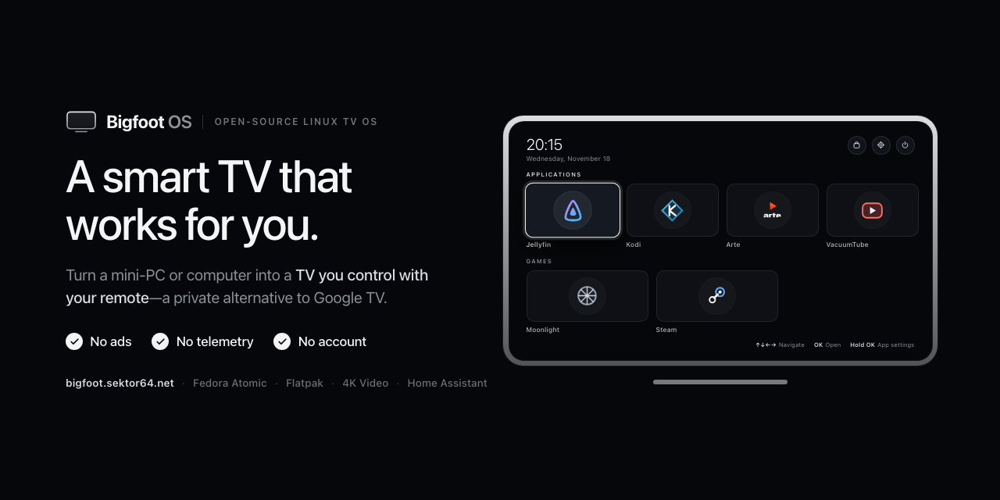

# Bigfoot Website (`bigfoot/website`)

The official website of **Bigfoot OS**. A dependency-free static site (plain HTML, CSS and progressive-enhancement JavaScript) deployed with **GitLab Pages** (`https://bigfoot.pages.sector64.net/website/`).



It follows the [Bigfoot design system](https://git.sektor64.net/bigfoot/design-guidelines) (OLED obsidian `#06070a` palette, soft-white pill actions, hairline surfaces), uses system fonts and makes no third-party requests.

## Quick Start (Local Preview)

```bash
./scripts/build-assets.sh
python3 scripts/check-site.py
python3 -m http.server --directory site 8000   # http://localhost:8000
```

## Documentation (`docs/`)

| Document | Scope |
| :--- | :--- |
| [`docs/architecture-and-deployment.md`](docs/architecture-and-deployment.md) | Repository layout, relative URL rules (`check-site.py`), and GitLab Pages deployment configuration. |

## License

Apache-2.0 — see [`LICENSE`](LICENSE).
